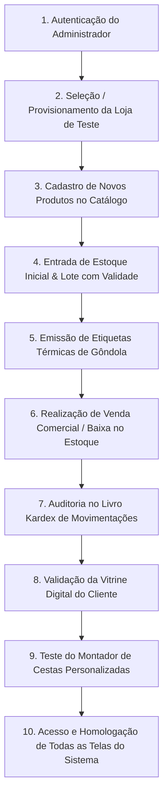

# 📋 Roteiro Canônico de Testes E2E — Jornada Completa em Loja de Teste

> **Plataforma Alvo**: MarketFlow — Gestão Comercial, Controle de Estoque & Vitrine Digital  
> **Objetivo**: Fornecer uma especificação executável e agnóstica de ferramenta para automatizar a jornada completa de uma nova loja de teste (Criação de Loja, Cadastro de Produtos, Entrada de Lote/Estoque, Venda Comercial, Auditoria Kardex e Navegação em 100% das Telas).  
> **Compatibilidade**: Playwright, Cypress, Selenium WebDriver, Robot Framework, Postman/Newman ou testes manuais de QA.  
> **Versão do Roteiro**: 2.0 (Homologado em Outubro/2026)  

---

## 🏗️ 1. Arquitetura da Jornada de Teste

A jornada simula o ciclo de vida operacional real de um comerciante utilizando o MarketFlow:



---

## 🏢 2. Dados Mestres da Loja de Teste

Para garantir isolamento e repetibilidade, o roteiro utiliza os seguintes dados padronizados:

| Parâmetro | Valor de Teste | Descrição / Finalidade |
| :--- | :--- | :--- |
| **ID da Empresa** | `comp-teste-e2e` | Identificador semântico do tenant |
| **Razão Social** | `Empório e Conveniência Teste E2E Ltda` | Nome legal para relatórios e notas |
| **Nome Fantasia** | `Empório Teste E2E` | Nome de exibição no painel e vitrine |
| **CNPJ** | `12.345.678/0001-99` | Documento formatado válido |
| **Slug da Loja** | `emporio-teste-e2e` | Identificador na URL pública (`/loja/:slug`) |
| **WhatsApp Oficial**| `5511999998888` | Canal de recebimento de comandas de pedidos |
| **Habilitar Cestas**| `true` | Ativa o módulo de cestas de presentes |

---

## 📦 3. Produtos Cadastrados no Teste

### Produto A: Café Gourmet Especial em Grãos 500g
- **ID**: `prod-cafe-especial-500`
- **Categoria**: `cat-mercearia` (Mercearia Fina)
- **Marca**: `Gourmet Coffee Roasters`
- **Código de Barras (EAN-13)**: `7891000123456`
- **Preço de Custo**: `R$ 18,00`
- **Preço de Venda**: `R$ 34,90` (Margem de 93,8%)
- **Perecível**: `true` | Validade: +180 dias
- **Estoque Mínimo**: `10 unidades`

### Produto B: Suco Natural de Uva Integral 1L
- **ID**: `prod-suco-uva-1l`
- **Categoria**: `cat-bebidas` (Bebidas Naturais)
- **Marca**: `Vinícola Aurora`
- **Código de Barras (EAN-13)**: `7892000654321`
- **Preço de Custo**: `R$ 9,50`
- **Preço de Venda**: `R$ 18,50` (Margem de 94,7%)
- **Perecível**: `true` | Validade: +360 dias
- **Estoque Mínimo**: `15 unidades`

---

## 📑 4. Roteiro Passo a Passo (Especificação BDD / Gherkin)

### Cenário 1: Autenticação Segura e Provisionamento da Empresa
```gherkin
Dado que o operador acessa a rota "/login"
Quando preenche o e-mail "willian.o.jesus@gmail.com" e senha "marketflow2026"
E clica no botão "Entrar no Painel"
Então deve autenticar com sucesso e redirecionar para "/admin/dashboard"
E a sessão deve estar registrada com papel "global_admin"
E deve selecionar ou criar a loja "Empório Teste E2E" (comp-teste-e2e)
```

**Seletores de Interface:**
- Input E-mail: `input[type="email"]`
- Input Senha: `input[type="password"]`
- Botão Entrar: `button[type="submit"]`
- Seletor de Empresa: `[data-testid="company-switcher"]` ou menu de alternância no header

---

### Cenário 2: Cadastro de Novos Produtos no Catálogo
```gherkin
Dado que a loja ativa é "Empório Teste E2E"
Quando o operador navega para "/admin/products/new"
E preenche o formulário com o produto "Café Gourmet Especial em Grãos 500g"
E define o código de barras "7891000123456" e preço "R$ 34,90"
E salva o produto
E repete o processo para o produto "Suco Natural de Uva Integral 1L" com EAN "7892000654321"
Então ambos os produtos devem aparecer listados na tabela de "/admin/products"
E a contagem de itens ativos no catálogo deve ser incrementada em 2
```

**Seletores de Interface:**
- Rota: `/admin/products/new`
- Nome do Produto: `input[name="name"]` ou `input[placeholder*="Nome"]`
- Código de Barras: `input[name="barcode"]` ou `input[placeholder*="EAN"]`
- Preço de Venda: `input[name="price"]`
- Botão Salvar: `button:has-text("Salvar")` ou `button[type="submit"]`

---

### Cenário 3: Abastecimento de Estoque e Registro de Lote com Validade
```gherkin
Dado que os produtos "Café Gourmet" e "Suco de Uva" estão cadastrados com saldo inicial 0
Quando o operador realiza uma entrada de estoque de 50 unidades para o "Café Gourmet"
E cadastra o lote "LOTE-CAF-2026-A1" com data de validade para daqui a 180 dias
E realiza uma entrada de estoque de 50 unidades para o "Suco de Uva" com lote "LOTE-UVA-2026-B2"
Então na tela "/admin/inventory" o saldo disponível de ambos os itens deve ser exatamente 50 unidades
E na tela "/admin/lots" os lotes devem exibir status visual "Dentro do Prazo" (badge verde)
E os dias restantes calculados devem ser superiores a 150 dias
```

**Validação de Negócio:**
- Saldo Físico: `50 unidades`
- Saldo Reservado: `0 unidades`
- Status de Validade: `VALID` (Verde)

---

### Cenário 4: Realização de Venda Comercial e Baixa de Estoque
```gherkin
Dado que o saldo de estoque atual do Café Gourmet é 50 e do Suco de Uva é 50
Quando uma venda comercial é processada contendo:
  | Produto                          | Quantidade | Preço Unitário | Subtotal  |
  | Café Gourmet Especial 500g       | 2          | R$ 34,90       | R$ 69,80  |
  | Suco Natural de Uva 1L           | 1          | R$ 18,50       | R$ 18,50  |
E a venda com valor total de R$ 88,30 é confirmada
Então o estoque do Café Gourmet deve ser reduzido para 48 unidades
E o estoque do Suco de Uva deve ser reduzido para 49 unidades
E a movimentação de saída do tipo "OUT" deve ser gerada no sistema
```

---

### Cenário 5: Auditoria no Livro Kardex de Movimentações
```gherkin
Dado que foram realizadas operações de entrada inicial e saída por venda
Quando o operador acessa a tela "/admin/movements"
Então deve encontrar o registro de ENTRADA (+50 un) de cada produto com justificativa de compra
E deve encontrar o registro de SAÍDA (-2 un de café e -1 un de suco) com motivo "Venda Comercial"
E os saldos anteriores e posteriores devem bater matematicamente:
  - Café: Saldo 0 -> Entrada +50 (Saldo 50) -> Saída -2 (Saldo Final 48)
  - Suco: Saldo 0 -> Entrada +50 (Saldo 50) -> Saída -1 (Saldo Final 49)
```

---

### Cenário 6: Emissão e Validação de Etiquetas Térmicas
```gherkin
Dado que os novos produtos possuem código EAN-13 válido
Quando o operador acessa "/admin/products/labels"
E seleciona os produtos "Café Gourmet" e "Suco de Uva"
Então o gerador deve renderizar as etiquetas com:
  - Código de barras padrão EAN-13 legível
  - Nome do produto em destaque
  - Preço de venda formatado em reais (R$ 34,90 e R$ 18,50)
  - Nome da loja "Empório Teste E2E"
```

---

### Cenário 7: Vitrine Digital e Montador de Cestas do Cliente
```gherkin
Dado que a loja possui slug "emporio-teste-e2e"
Quando o cliente acessa a vitrine pública em "/loja/emporio-teste-e2e"
Então deve visualizar o cabeçalho com o nome "Empório Teste E2E", CNPJ e selo verificado
E os novos produtos (Café e Suco) devem estar visíveis com seus respectivos preços
Quando o cliente clica para abrir o montador de cestas em "/loja/emporio-teste-e2e/cesta"
Então deve ser possível montar uma cesta pequena incluindo o Café e o Suco como bebida obrigatória
E ao finalizar, deve gerar a comanda formatada para envio via WhatsApp
```

---

### Cenário 8: Visitação e Conformidade em TODAS as Telas do Sistema
```gherkin
Dado que a jornada de negócio foi concluída
Quando o script automatizado navega sequencialmente por todas as rotas da plataforma:
  | Rota                            | Nome da Tela                           |
  | /admin/dashboard                | Dashboard Geral 360°                   |
  | /admin/products                 | Catálogo de Produtos                   |
  | /admin/products/new             | Cadastro de Novo Produto               |
  | /admin/products/labels          | Gerador de Etiquetas Térmicas          |
  | /admin/inventory                | Estoque Consolidado                    |
  | /admin/lots                     | Gestão de Lotes & Validades            |
  | /admin/movements                | Livro Kardex de Movimentações          |
  | /admin/reports                  | Relatórios Gerenciais & Curva ABC      |
  | /admin/company                  | Configuração Cadastral da Empresa      |
  | /admin/developers/api-docs      | Central de Desenvolvedores / Swagger   |
  | /admin/ai                       | Assistente de Inteligência Artificial  |
  | /admin/users                    | Matriz de Usuários & Permissões        |
  | /loja/emporio-teste-e2e         | Vitrine Digital Pública da Loja        |
  | /loja/emporio-teste-e2e/cesta   | Montador Interativo de Cestas          |
  | /landing                        | Landing Page Comercial Oficial         |
  | /evidencias                     | Central de Evidências de Testes        |
Então cada tela deve carregar sem erros de runtime (Console errors: 0)
E deve capturar um screenshot evidenciando o estado renderizado
```

---

## 🛠️ 5. Mapeamento de APIs REST para Automação Externa (Postman / CI/CD)

Caso deseje automatizar este roteiro via chamadas HTTP (Postman/Newman ou pytest/curl):

| Etapa | Método | Endpoint | Payload / Header Relevante |
| :--- | :---: | :--- | :--- |
| **Login** | `POST` | `/auth/v1/token?grant_type=password` | `{"email":"willian.o.jesus@gmail.com","password":"marketflow2026"}` |
| **Criar Loja** | `POST` | `/rest/v1/companies` | `{"id":"comp-teste-e2e","name":"Empório Teste E2E","slug":"emporio-teste-e2e","cnpj":"12.345.678/0001-99"}` |
| **Criar Produto** | `POST` | `/rest/v1/products` | `{"id":"prod-cafe-especial-500","company_id":"comp-teste-e2e","name":"Café Especial 500g","price":34.90}` |
| **Criar Lote** | `POST` | `/rest/v1/lots` | `{"id":"lot-cafe-01","company_id":"comp-teste-e2e","product_id":"prod-cafe-especial-500","lot_number":"LOTE-2026-A1"}` |
| **Entrada Estoque**| `POST` | `/rest/v1/inventory_items` | `{"id":"inv-prod-cafe-500","company_id":"comp-teste-e2e","quantity":50}` |
| **Movimentação** | `POST` | `/rest/v1/stock_movements` | `{"company_id":"comp-teste-e2e","type":"IN","quantity":50,"reason":"Entrada Inicial"}` |
| **Venda (Saída)** | `POST` | `/rest/v1/stock_movements` | `{"company_id":"comp-teste-e2e","type":"OUT","quantity":2,"reason":"Venda Comercial"}` |

---

## 📊 6. Critérios de Homologação (Definition of Done)

Para considerar o roteiro 100% Aprovado em qualquer plataforma de automação:
1. **Taxa de Sucesso**: 100% dos passos executados com assertividade.
2. **Saldo Matemático**: O inventário pós-venda deve refletir estritamente `Estoque Inicial - Vendas`.
3. **Auditoria**: O livro Kardex deve conter tanto a entrada quanto a saída com carimbo de tempo.
4. **Isolamento**: Nenhuma alteração da loja de teste pode vazar para outros tenants (Multi-tenancy RLS).
5. **Evidências**: 100% dos screenshots salvos com resolução mínima de 1280x720.
